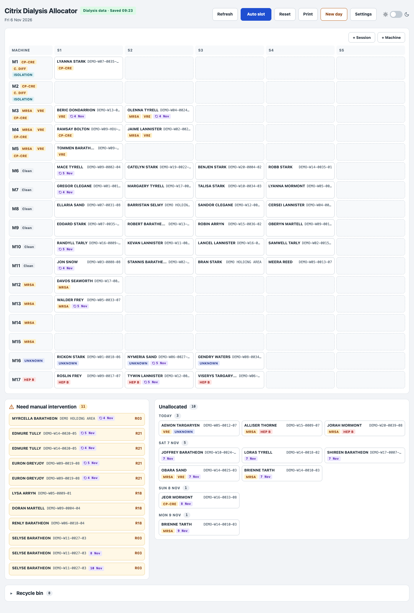
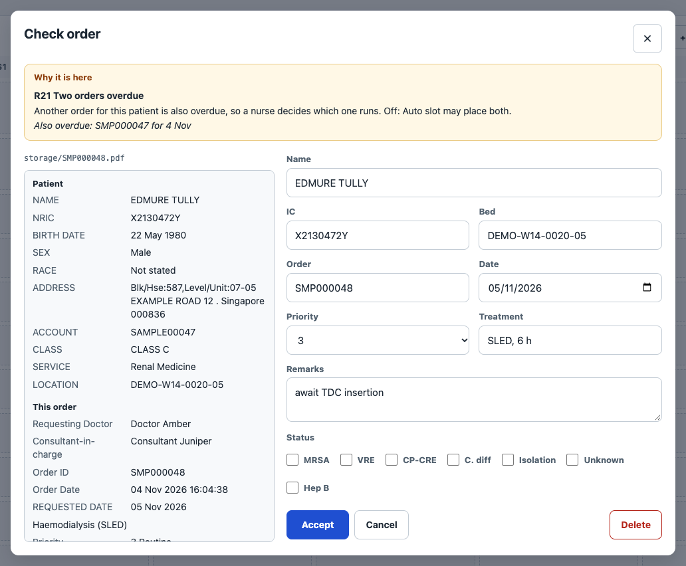
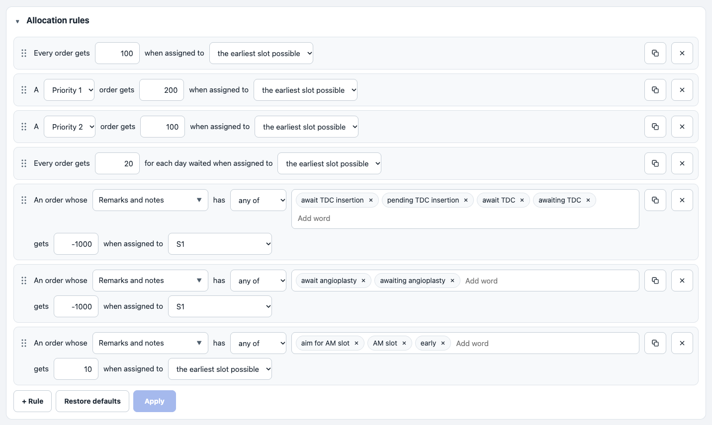

# Citrix Dialysis Allocator

A one-file tool that runs offline in a browser. It reads haemodialysis orders printed as PDFs from a Citrix-based order system, checks them, and arranges them on a board of dialysis machines and sessions.

- This is an open-source personal project by [Arthur Yong](https://github.com/arthurjyong), built with Claude.
- All data in this repository is synthetic.
- This project is not affiliated with or endorsed by Citrix Systems. The name only describes the kind of order system it reads from.
- This is not a medical device, and it has not been validated for clinical use.



## The problem

A hospital dialysis centre receives many orders a day. Each order covers one session. Someone has to match every order to a machine and a session, and the rules are easy to say but tiring to hold in your head:

- A patient's infection status decides which machines they may use, and hepatitis B must stay apart from everything else.
- Emergencies go first, and an order that has waited should not wait forever.
- Free-text remarks matter. "Await TDC insertion" (a tunnelled dialysis catheter still to go in) means not the first session. "Aim for AM slot" means as early as possible.
- Orders arrive for later days, some are unclear, and some should not run until a person has looked at them.
- The plan changes during the day, and it must be possible to see who changed what.

## The approach

The tool does the arranging and leaves the judgement with the nurse. Clear orders are placed by a solver. Unclear ones stop, with a reason a person can read. Anything can be moved by hand, and every action goes into a diary.

It has two modules.

**Module 1, the reader.** It takes each PDF from an orders folder and turns it into one structured record. The PDF parser is written from scratch inside the page, with no library. Each file is stored with its checksum. An order that is unreadable or incomplete stops for a nurse with a reason code, such as `R18 No vascular access` or `R21 Two orders overdue`.



**Module 2, the board.** Machines are rows and sessions are columns. Two rule books drive it, and both are edited on screen as plain sentences, with no code:

- Matching rules are hard. They tick a patient's statuses from the order, and a machine takes a patient only if it is ticked with every status the patient carries.
- Allocation rules are soft. Each is a sentence that gives points to an order in a session, and a patient's score for a seat is the sum.

Auto slot then finds the arrangement with the highest total score. This is an assignment problem, so it is solved exactly with the Hungarian method. The same board always gives the same answer.



The details are in [docs/how-it-works.md](docs/how-it-works.md).

## How to run it

You need Chrome or Edge, on a Mac or on Windows. Safari and Firefox cannot give a page access to a folder. Nothing is installed, and the page loads nothing from the internet.

1. Download this repository and open `allocator.html` by double-clicking it.
2. Click Choose data folder, pick an empty folder anywhere, and allow access. The tool makes a folder called `orders` inside it.
3. Copy the PDFs from `sample-orders/` into that `orders` folder. The tool moves each file it reads, so working from a copy keeps `sample-orders/` whole.
4. Click Settings and switch Review new orders off, then click Back to board. With the switch on, every order waits for a nurse to press Accept.
5. Click Refresh to read the orders, then Auto slot to fill the board.

The sample orders are dated around the day they were made, so later they show as overdue. This command dates them around today, and needs only Python 3:

```
python3 tools/make_sample_orders.py
```

The tool keeps its work as plain files in the data folder: `state.json` is the board, `log.jsonl` is the diary with one line per action, and `copies/` holds the copies made at Print and New day.

## All data is synthetic

All data in this repository is synthetic. Every order is made by [tools/make_sample_orders.py](tools/make_sample_orders.py) from random numbers and word lists, and the script reads no input file.

- Patient names are characters from *Game of Thrones*, so nobody takes them for real people. The project has no link to the books or the show.
- Doctors, addresses, wards and clinical values are all invented, and each order is marked as a synthetic sample.
- IC numbers start with X, which no real one does.
- The dialysis operators named on the orders are real, as open facts. Their branches, addresses and numbers are invented.
- The board of 17 machines and 5 sessions, the rules and their points are an example setup. Change them in Settings.

## Using it for your own department

Any clinical department that arranges its dialysis orders through a Citrix-based system may be able to derive some use cases for itself. You are welcome to get in touch by [opening an issue](https://github.com/arthurjyong/citrix-dialysis-allocator/issues) or through my [GitHub profile](https://github.com/arthurjyong).

Two things to know first. The tool does not connect to Citrix or to anything else: it only reads PDF files from a folder. And the reader looks for the box names of one order form, so a different form means changing that list.

## Licence

[MIT](LICENSE), copyright Arthur Yong.
